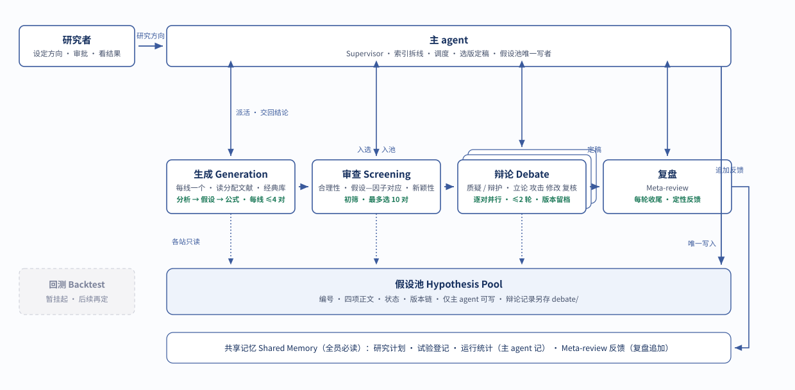

# Alpha-Mining-Harness — 因子挖掘研究

一套给通用 Agent 用的因子研究环境，在标普 500 历史成分股的日频价量数据上做因子挖掘研究。

主 agent（Supervisor）负责索引、拆线、调度与选版定稿；生成、审查、辩论、复盘各由专职 subagent 执行。研究单位是「假设—因子对」，对子在假设池中流转：生成 → 初筛入池 → 辩论产出版本 → 主 agent 选版定稿 → 每轮收尾复盘，跨轮反馈写进共享记忆。脚本只负责计算，不做判定。



## 一轮怎么跑

1. **任务与索引**：研究者给出研究方向，主 agent 记入共享记忆的研究计划，先读 `research/literature_notes.md` 常驻库、按机制线分配已有文献，不足再做摘要级检索补齐；按机制拆成 2–3 条线，把文献分配到各线（同时支撑两条线的文献标为共享）。一条机制线累计 2 次失败即判不可行（换锚一次计 1 次，构造不可行一次计 1 次；每次失败分类为锚点/构造/识别不可行）。同一方向连续两轮 0 对，下一轮须换家族，除非拿出新字段、新评价协议或新的全文锚点。方向选择约束：先找可分变量再选机制；动量方向已被经典库占满，再做动量须同时满足锚点同构、可识别符号、门与 C23/C25 正交、模板非 C24，否则换方向。选题时先核对证据/判定层匹配：锚点须是 20 日个股截面证据，否则先在选题阶段改评价协议，或不选该方向。
2. **生成**：每条线一个生成 agent，独立上下文、互不可见。读分配到的文献（选 1–2 篇读全文）与经典库，按「分析 → 假设 → 公式」产出：笔记除登记外须写分析结论（文献证明了什么、没证明什么、证据缺位在哪），笔记内容随交回由主 agent 落盘；假设的符号与期限须能由机制唯一推出；公式逐项对应机制，并与假设池、经典库比对不重复。四项交付：假设、公式、出处、机制—公式合同，另附锚点五维同一性表与零假设期望值，每线最多 4 对。
3. **初筛与入池**：审查 agent 汇总全部候选，按四项前置检查（锚点五维同一性、零假设期望值、判定期硬前置、状态是否进入截面排序）与假设合理性、假设—因子对应、新颖性三项初筛，排掉不达标者，最多选 10 对，逐条给出理由。主 agent 按入选名单入池建档，状态记为待辩论。
4. **辩论与定稿（逐对并行）**：每对一个辩论单元。生成 agent 先立论，把假设展开成机制链；质疑 agent 按攻击方向组织攻击（同根因合并，代数同构为固定一类，须给推导）；生成 agent 逐条回应并按双方一致的结论修改——每处修改对应一个攻击编号，目标是纠正，修改清单含改前改后；质疑复核修改是否回应攻击、是否引入新问题。最多 2 轮（首轮复核后锚点级缺陷直接收口，不进第二轮），过程中每个版本留档。辩论结束，主 agent 读辩论记录，在全部版本中选最合适的一版定稿，状态记为待验证。辩论不淘汰对子；生成方判应弃且主 agent 同意的，仲裁记为已淘汰留档。
5. **复盘（Meta-review）**：本批对子全部定稿后，复盘 agent 汇总本轮反复出现的问题，写成定性反馈记入共享记忆，供下一轮所有 agent 开工前读。本轮 0 对入池也是合法收口，留档三项（致命攻击编号与不可修论证、重启条件、可行性判断是否改变）；重启条件须附构造可行性论证；连续两轮 0 对的，复盘把「换方向」列为标准选项。

回测暂未接入本流程，衔接方式后续再定；回测工具与纪律保留在下方。

## 文件结构

| 路径 | 内容 |
|---|---|
| `SKILL.md` | 总说明书（主 agent）：班子分工、一轮流程、池子纪律、环境、工具 |
| `.opencode/agent/` | 四个 subagent 定义（含权限配置）：factor-generator（生成与辩护）、factor-reviewer（审查）、factor-challenger（质疑）、meta-reviewer（复盘） |
| `research/hypothesis_pool.md` | 假设池：对子档案与状态，主 agent 维护 |
| `research/shared_memory.md` | 共享记忆：研究计划、试验登记、运行统计、Meta-review 反馈 |
| `research/experiment_registry.md` | 实验登记：进入 IS 前冻结的版本登记（公式哈希、方向、持有期、指标、OOS 规则） |
| `research/literature_notes.md` | 文献笔记：论文登记与分析结论，主 agent 落盘 |
| `research/debate/` | 辩论记录：一对一文件，按编号命名 |
| `classic_library.md` + `classic_library/` | 经典因子库索引与原文：200 条，13 个家族 |
| `engine.py` | 计算引擎：读数据、公式求值（33 个算子）、白名单检查 |
| `tools/check_formula.py` | 公式校验：结构、字段、算子合法性，报告算子调用数作参考，不接触数据 |
| `tools/backtest/` | 三个回测脚本，各管一段（IS / OOS / holdout），结果存入 `results/` |
| `tools/search/` | 文献检索脚本：openalex.py、core.py、arxiv.py |
| `report.py` | 单文件 HTML 报告：多空累计收益图、指标表、分年表 |
| `requirements.txt` | Python 依赖清单（pandas、numpy、pyarrow） |
| `traces/` | 运行记录：每轮全程 trace 导出留档（不进仓库） |
| `data/` | 数据文件（见下方 Data 一节，从 Release 下载，不在仓库内） |

## Install with opencode (recommended)

opencode 本体不在本仓库内，需先安装：有 Node.js 的环境（Windows / macOS / Linux 通用）运行 `npm install -g opencode-ai`；也可以用各系统的包管理器（Windows 的 scoop / choco、macOS 的 brew）。装好并连上模型（如 DeepSeek）后，把下面整段粘贴给它：

```
You are installing the Alpha-Mining-Harness factor research system.

Do the following, then print a checklist table (OK / FAIL):
1) Ensure git and python (>=3.10) exist. Install the Python packages:
   pip install -r requirements.txt
2) Clone or update the repo into the working folder:
   git clone https://github.com/sun97956/Alpha-Mining-Harness.git
   (if it already exists, git pull instead)
3) Arrange the files for opencode:
   - Copy SKILL.md to AGENTS.md in the project root (always-on instructions).
   - The subagent definitions under .opencode/agent/ are already in the repo; nothing to copy.
4) API keys for the literature search scripts: copy .env.example to .env in the
   project root and fill in OPENALEX_API_KEY and CORE_API_KEY
   (environment variables work too and take precedence).
5) Data is NOT in the git repo. Download the four parquet files from the repo's
   Release (tag: data) into data/: panel.parquet, securities.parquet,
   membership_intervals.parquet, spy_benchmark.parquet. See the Data section below.
6) Quick check (IS segment only):
   python tools/backtest/backtest_is.py "-(close / delay(close, 20) - 1)"
   Expected: 20日IC 0.0115, ICIR 0.075, and a JSON saved under results/.

Print versions and pass/fail for each step. Stop after the checklist.
```

Manual fallback: clone the repo, run `pip install -r requirements.txt`, do step 3 to 5 by hand, run the quick check in step 6.

## Data

数据文件不进 git 仓库，以 Release 附件分发：到仓库的 Releases 页下载 tag `data` 的四个文件，放进项目根目录的 `data/` 文件夹。

| 文件 | 内容与用途 |
|---|---|
| `panel.parquet` | 行情主表：1,195 只标普 500 历史成分股，2000-01-03 至 2026-09-30，日频开、高、低、收、成交量、总市值。engine.py 读入后按字段拆成宽表，是全部计算的原料 |
| `securities.parquet` | 每只股票的 GICS 行业分类，供行业内排名与行业均值使用 |
| `membership_intervals.parquet` | 每只股票进出标普 500 的起止日期。加载时按它过滤，股票只在成分期内有值 |
| `spy_benchmark.parquet` | 每日市场收益，公式中的 mktret 来自这里 |

口径与生成物：

- 价格为拆股调整后价格。
- `data/precomp_fields.parquet` 是程序自动生成的缓存（ivol20、resid_ret 两个自算字段），首次运行时生成，不用下载；删掉后会自动重建。

## Discipline

- 公式校验只查合法性（`tools/check_formula.py`），不设算子数上限；复杂度由初筛与辩论判断。
- 权限：写入分工由各 subagent 定义中的权限配置强制执行——假设池仅主 agent 可写、bash 按角色白名单开放。
- 运行记录：每轮结束用 `opencode session export <会话ID> --sanitize` 脱敏导出全程 trace 至 `traces/` 留档；逐个会话重定向落盘为 .json，打包用原始文件；不要把 .env 密钥带进 trace（编辑器里点选 .env 的行会把密钥写进会话），分享前先检查。
- 流程内不接触数据：各 agent 只知道数据有哪些（字段、区间、口径），不读行情数值、不自算统计量；与数据有关的量只出自回测成绩单。
- 日常研究只跑 IS 段（`tools/backtest/backtest_is.py`）。
- OOS 段（`tools/backtest/backtest_oos.py`）须经人确认后才跑。
- holdout 段封存：未经明确指令，不运行 `tools/backtest/backtest_holdout.py`。
- 判定参考线：20 日 IC ≥ 0.02、ICIR ≥ 0.2。
